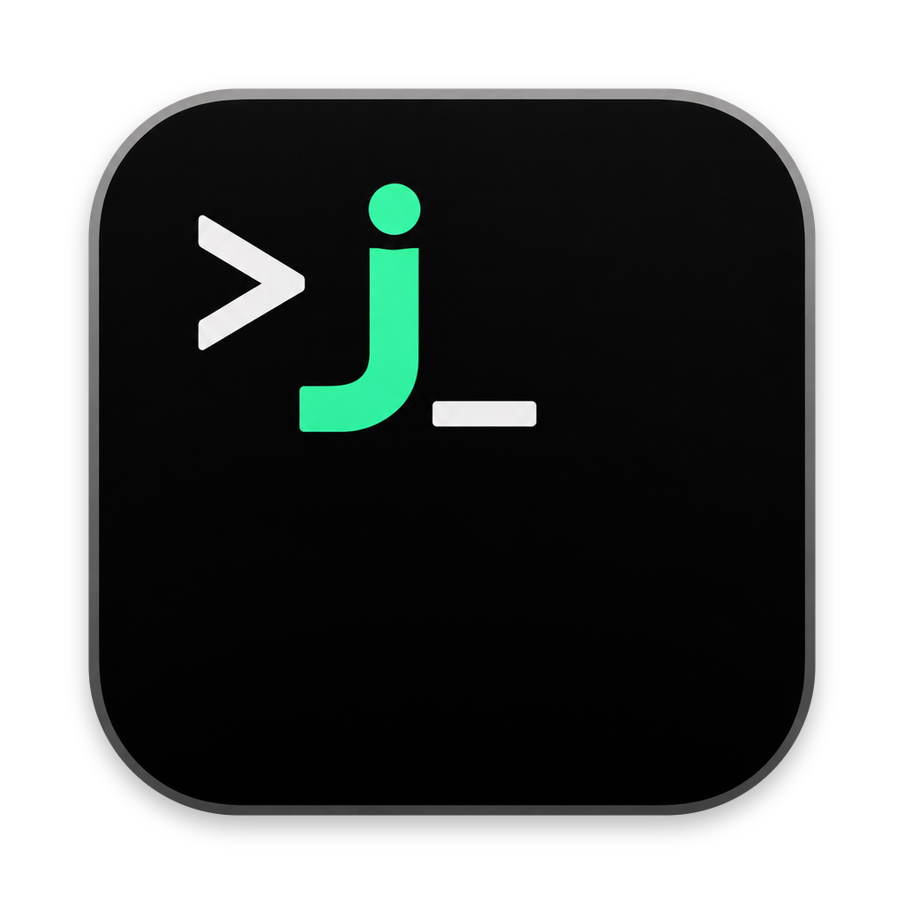

<p align="left">
  
</p>

# jterm (Rust + Metal + CoreText + AppKit)

A native, minimal, ultra-fast macOS terminal emulator written in Rust with drop-in iTerm2 profile/plist/keymap compatibility, native Apple Metal GPU rendering, CoreText ligatures & `NSTextInputClient` IME, live PTY-wrapped `scp` Transfer Queue, and zero-wakeup macOS energy efficiency. Cross-compiled into an ad-hoc signed Universal (`arm64` + `x86_64`) macOS `JTerm.app` bundle and Linux x86_64 CLI/benchmark tool.

## Highlights

- **Ultra-fast VT & Scrollback Engine (`crates/iterm-vt`)**
  - Hardware SIMD ASCII scanning (32-byte unrolled SSE2 on x86_64, 16-byte NEON 64-bit nibblemask on Apple Silicon)
  - Direct-to-scrollback bulk ASCII fast path, zero-`CsiParams` inline `SGR`/`CUP`/`EL`, O(1) `row_order` `DECSTBM` scroll rotation (`tmux`), and dual-tier 1-byte/char ASCII + 16-byte styled recycled-slab scrollback (100k lines in 13.78 MiB RAM)
  - Full `Cell` (16 B `align(16)`) + auto-GC'd side tables (`CellExtra` / hyperlinks / grapheme tails / inline images), Unicode combining marks & ZWJ emoji clusters, soft-wrap + scrollback pull-back resize reflow, DEC Special Graphics (`ESC ( 0` / `B`, `SO`/`SI`), `DCS tmux;` passthrough unwrapping, `OSC 4/6/7/8/9/10/11/12/52/133/777/1337`, `DECRQM`, `XTGETTCAP`, `DECSTR`, `DECSET 1004` FocusIn/Out, and `CSI 22/23 t` title stack
- **Native Metal GPU Renderer (`crates/iterm-render`, `crates/iterm-app`)**
  - Dual-plane glyph atlas: `4096x4096 R8Unorm` monochrome text (1 B/px) + `1024x1024 RGBA8Unorm` Apple Color Emoji in a single instanced draw call
  - 3-permit GPU completion fence (`InFlightFence` + `MTLCommandBuffer.addCompletedHandler`) gating `TripleRingBuffer` persistent Metal buffers, with live hardware `GPUStartTime`/`GPUEndTime` telemetry (`Cmd+Opt+I` Performance HUD)
  - Scroll-invariant `row_gen` cache + lock-free incremental `PaneSnapshot` + lock-free L1 ASCII `AtlasEntry` lookup + collision-safe generational LRU shaper cache
  - Pixel-exact procedural Box Drawing (`U+2500..=U+257F`), Block Elements (`U+2580..=U+259F`), Braille (`U+2800..=U+28FF`), and anti-aliased SDF Powerline separators (`   `) + luminance-aware Retina text gamma
  - Flicker-free `Cmd+Tab` transitions (`NSViewLayerContentsRedrawPolicy::Never`, Dark/Light `NSAppearance` matching theme luminance, and theme-matched `CAMetalLayer` `CGColor` backing)
- **macOS Energy Efficiency & Zero-Wakeup Idle**
  - **0.00 idle wakeups/sec**: zero permanent repeating `NSTimer`s and infinite kernel `poll(-1)` sleep across all idle PTY tabs/panes (enabling full macOS App Nap and deep Apple Silicon C-states)
  - **Zero GPU when occluded / minimized / hidden / background tabs**: checks `NSWindowOcclusionState::Visible`, skips Metal submits when inactive tabs or no-op PTY bursts produce zero visible changes, and repaints in `<1 ms` on reveal
  - **Honors macOS `reduceTransparency` & Low Power Mode**: respects `NSWorkspace.accessibilityDisplayShouldReduceTransparency()` live (full opaque surface bypassing `WindowServer` alpha-blending), adaptive 120 Hz / 60 Hz LPM / 30 Hz unfocused flood cap, and integrated low-power GPU selection (`MTLCopyAllDevices` + `isLowPower()` + `NSSupportsAutomaticGraphicsSwitching`)
- **iTerm2 Compatibility & Native macOS UX (`crates/iterm-profile`, `crates/iterm-pty`, `crates/iterm-app`)**
  - Direct XML/binary `com.googlecode.iterm2.plist`, `DynamicProfiles/*.json`, and `.itermcolors` import (profiles, keymaps, Smart Selection Rules, Semantic History, Dracula+ & custom color presets)
  - Compact 26 pt unified titlebar tabs level with macOS traffic lights, split panes with drag dividers & inactive dimming, `Cmd+,` native Preferences panel, `Cmd+U` transparency toggle, `Cmd+F` inline search, right-click context menu, trackpad pinch-to-zoom, Carbon global hotkey, full `NSTextInputClient` IME (CJK, dead keys, Emoji picker), Left/Right Option separation, and Kitty keyboard protocol (`CSI u`)
  - Non-blocking async PTY `POLLOUT` write queue, zero-sleep 256 KiB reader, bounded `TransferQueue` with zero-dependency PTY-wrapped live `scp` progress HUD (`Cmd+Opt+L`), `OSC 1337;Artifact=` deterministic `Cmd+Click` downloads, `it2dl`/`imgcat`, and `Cmd+V` / drag-and-drop automatic SSH ControlMaster `scp` uploads

## Architecture

| Crate | Purpose |
| --- | --- |
| `crates/iterm-profile` | iTerm2 XML/binary `.plist`, Dynamic Profiles JSON, and `.itermcolors` parser (profiles, color schemes, `Keyboard Map`, `GlobalKeyMap`, `Hotkey`, `Smart Selection Rules`, `Semantic History`). |
| `crates/iterm-vt` | SIMD VT100/xterm/iTerm2 parser, `DCS tmux;` unwrapper, 16-byte `Cell`, O(1) `row_order` `ActiveGrid`, dual-tier recycled-slab `Scrollback`, auto-GC side tables, grapheme clusters, and resize reflow. |
| `crates/iterm-pty` | POSIX PTY with iTerm2 env & launchd UTF-8 fallback, 256 KiB coalesced reader + non-blocking async `POLLOUT` writer, binary split-pane tree, multi-tab manager, and PTY-wrapped live-progress OpenSSH ControlMaster `scp` `TransferQueue`. |
| `crates/iterm-render` | Dual R8/RGBA8 glyph atlas, scroll-invariant `row_gen` cache, lock-free incremental `PaneSnapshot`, procedural Box/Block/Braille/Powerline geometry, generational LRU shaper cache, and Metal shaders (`shaders/terminal.metal`). |
| `crates/iterm-app` | Native macOS `NSApplication`/`NSWindow` delegates, `CAMetalLayer` Metal renderer, CoreText ligature shaper, `NSTextInputClient` IME, `Cmd+,` Preferences window, Carbon global hotkey, and cross-platform CLI/benchmark runner (`jterm`). |

## Measured Performance (Linux x86_64, `--release`)

| Benchmark (250x80 grid) | jterm | Reference |
| --- | ---: | --- |
| `kitten` ASCII single-chunk (8 MiB) | **6,666.2 MB/s** (1.20 ms) | Ghostty 1.4 parser: 725 MB/s; Kitty: 121.8 MB/s |
| `stream64` ASCII 64 KiB chunks (8 MiB) | **4,763.8 MB/s** (1.68 ms) | Realistic PTY chunk streaming |
| `kitten` Unicode (4 MiB) | **444.5 MB/s** (9.00 ms) | Kitty: 105.0 MB/s; Alacritty: 46.5 MB/s |
| `kitten` CSI truecolor+cursor (4 MiB) | **1,065.6 MB/s** (3.75 ms) | Kitty: 59.8 MB/s; Alacritty: 32.5 MB/s |
| `kitten` Long escape OSC (16 MiB) | **15,691.9 MB/s** (1.02 ms) | Kitty: 251.6 MB/s |
| `kitten` 4-workload **Geometric Mean** | **2,653.1 MB/s** | Kitty 0.33 mean: 134.6 MB/s |
| `vtebench` `scrolling_bottom_region` / tmux (4 MiB) | **17,336.2 MB/s** (0.23 ms) | O(1) `row_order` rotation + bulk scroll |
| `vtebench` `dense_cells` SGR/cell (4 MiB) | **1,061.0 MB/s** (3.77 ms) | Zero-`CsiParams` inline SGR |
| `vtebench` `alt_screen_random_write` (4 MiB) | **1,005.8 MB/s** (3.98 ms) | Inline `CUP` fast path |
| `iterm2` mixed truecolor+CSI (1 MiB) | **367.9 MB/s** (2.72 ms) | iTerm2 M4 Max: 53.49 ms (18.7 MB/s) |
| CPU frame prep 250x80 truecolor (cold / 1-dirty-row) | **0.24 ms / 0.027 ms (36,922 fps)** | iTerm2 M4 Max: 39.58–61.99 ms |
| 100,000-line Scrollback RAM & ingest | **13.78 MiB RAM / 2.1 ms** | Dual-tier 1 B ASCII + 16 B styled slabs |
| End-to-End 16 MiB POSIX PTY dump | **42.5 ms (376.3 MB/s)** | Foot 168 ms, Ghostty 1.4 195 ms, Kitty 212 ms |

> Note: Linux CPU frame prep uses `MockShaper` to benchmark row caching, snapshotting, and GPU instance building. On macOS, toggle the live hardware Metal `GPUStartTime`/`GPUEndTime` Performance HUD via **View -> Toggle Performance HUD** (`Cmd+Opt+I`).

## Download Prebuilt Releases

Download from GitHub Releases (`https://github.com/moomou/jterm/releases`):

- **macOS Universal (`arm64` Apple Silicon + `x86_64` Intel)**: `JTerm-v0.1.26-macos-universal.zip` (or `.tar.gz`)
  ```bash
  unzip JTerm-v0.1.26-macos-universal.zip -d /Applications/
  xattr -dr com.apple.quarantine /Applications/JTerm.app
  open /Applications/JTerm.app
  ```
- **Linux x86_64** (CLI profile inspector, benchmark suite, and bundled shell integration): `jterm-v0.1.26-linux-x86_64.tar.gz`
  ```bash
  tar -xzf jterm-v0.1.26-linux-x86_64.tar.gz
  ./jterm-v0.1.26-linux-x86_64/jterm --benchmark
  ```

### macOS Privacy & TCC Permissions (Screen Recording, Accessibility, etc.)

`JTerm.app` ships with full terminal `NS*UsageDescription` declarations in `Info.plist` and a sealed `.app` bundle code signature (`dev.moomou.jterm` + `Contents/_CodeSignature/CodeResources`) so child CLI tools cleanly attribute TCC permission prompts to **JTerm**. You can also trigger or check Screen Recording access directly from **JTerm -> Request Screen Recording Access…**.

Because public builds use an ad-hoc signature (no Apple Developer Team ID), macOS TCC ties ad-hoc grants to each build's CDHash and may require re-granting after an update. To keep Screen Recording / Accessibility grants permanently across upgrades on your Mac, run our helper once (and after future updates) to sign with a persistent local Keychain certificate:

```bash
./scripts/sign-local-macos.sh /Applications/JTerm.app
```

## Key Shortcuts (macOS)

| Shortcut | Action |
| --- | --- |
| `Cmd+T` / `Cmd+W` | New tab / close pane or tab |
| `Cmd+D` / `Cmd+Shift+D` | Split vertically / split horizontally |
| `Cmd+M` / `Cmd+H` | Minimize window (`Cmd+Opt+M` minimizes all) / Hide JTerm |
| `Cmd+Shift+Enter` | Maximize / restore active pane |
| `Cmd+Shift+[` / `Cmd+Shift+]` | Previous / next tab (`Cmd+1..8` jump by index, `Cmd+9` jumps to last tab) |
| `Cmd+U` | Toggle window transparency ON/OFF |
| `Cmd+,` | Open native Preferences window |
| `Cmd+F` / `Cmd+E` / `Cmd+G` / `Cmd+Shift+G` | Inline Find (supports `Cmd+V` paste, `Cmd+Backspace` clear, `Opt+Backspace` delete word) / Use Selection for Find / next / previous match |
| `Cmd+K` | Clear scrollback & screen buffer |
| `Cmd+Opt+L` | Toggle live SCP Transfers queue & progress overlay (cancel `[x]` / Clear) |
| `Cmd+Opt+I` | Toggle live Metal GPU Performance HUD |
| `Cmd+Click` | Semantic History (open URL / local file / SCP download remote artifact) |
| `Option+Double-Click` | Select whole logical line (follows soft-wrapped continuations) |
| `Option+Shift+Double-Click` | Select trimmed line text (ignores leading & trailing whitespace) |
| `Cmd+V` / Drag & Drop | Paste text, local file paths, or auto-upload files/screenshots via SSH `scp` |

## Building From Source

### Native macOS build
```bash
cargo test --workspace
cargo build --release --bin jterm
```

### Cross-compiling macOS Universal `JTerm.app` on Linux (no Xcode required)
Uses `rustup` Darwin targets (`aarch64-apple-darwin`, `x86_64-apple-darwin`), `rustup`'s bundled LLVM `ld64.lld` (`-adhoc_codesign`), and macOS SDK `.tbd` framework stubs:

```bash
./scripts/setup-macos-sdk.sh
./scripts/build-macos.sh
```

## Using Your Existing iTerm2 Profile

On macOS launch, `jterm` loads in order:
1. `--plist <path>` (if passed explicitly)
2. `~/.config/jterm/config.json` (saved via `Cmd+,` Preferences or `--import-plist`; automatically falls back to legacy `~/.config/iterm-minimal/config.json`)
3. `~/Library/Preferences/com.googlecode.iterm2.plist` (+ `DynamicProfiles/*.json`)

```bash
jterm --plist ~/Library/Preferences/com.googlecode.iterm2.plist --dump-profile
jterm --benchmark
```

## Deterministic SSH + tmux Shell Integration

Included under `JTerm.app/Contents/Resources/shell_integration/` (and in the Linux release archive):
- `it2artifact <file>`: prints a clickable path stamped with `OSC 1337;Artifact=...` (auto-wrapped in `DCS tmux;` passthrough inside tmux) for deterministic `Cmd+Click` OpenSSH ControlMaster `/usr/bin/scp` downloads into `~/Downloads`.
- `it2dl <file>`: tmux-safe inline multipart file download.
- `imgcat <image>`: tmux-safe inline Retina image rendering.
- `jterm-shell-integration.sh`: bash/zsh hook emitting `OSC 133` prompt marks + `RemoteHost` + `CurrentDir`.

## License

MIT — see `LICENSE`.
